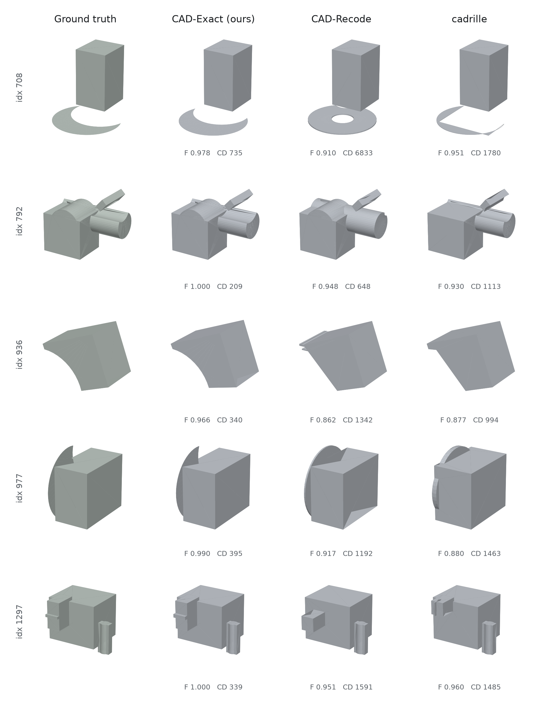
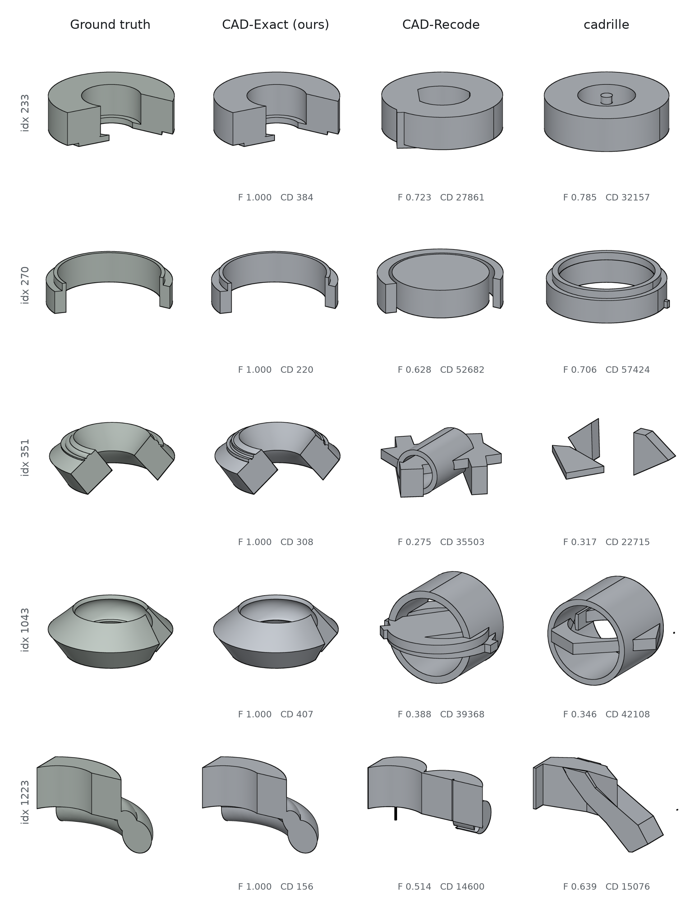
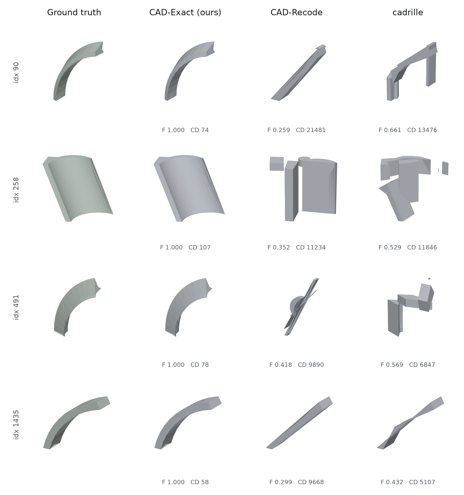
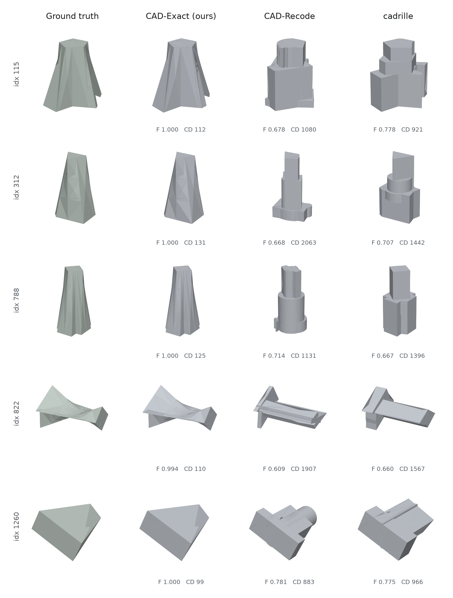

# CAD-Exact — inference release

Anonymous release for the CAD-Exact submission: **inference and evaluation** code
for parametric CAD code generation from point clouds, over the four solid-modeling
operations **extrude, revolve, sweep, loft**, plus the final model weights.

Training code is not part of this release. The released weights are the final
model of the four-stage chain (extrude → revolve → sweep → loft), already
LoRA-merged, so nothing has to be trained or fused to reproduce the numbers.

## Qualitative results

Ground truth against CAD-Exact and the two baselines, for each of the four
operations. Every predicted column is the solid obtained by *executing* the
generated CAD code, annotated with its F-score and Chamfer distance.

### Extrude



### Revolve



### Sweep



### Loft



Vector versions of the same figures are in `figures/` as `qualitative_<op>.pdf`.

## Repository layout

```
.
├── infer_batched.py               batched inference (per-op, one GPU shard)
├── eval.py                        evaluation, three metric tiers
├── local/
│   ├── model.py                   CADRecode (Qwen2-1.5B + point encoder)
│   ├── data_process.py            point-cloud sampling + FPS
│   ├── parquet_io.py              mesh decoding for the packed parquet corpus
│   └── run_setup.py               attention-kernel selection shared by all entry points
├── tools/
│   └── extract_test_from_parquet.py   parquet test split -> per-op dirs + JSON
├── scripts/
│   ├── infer_and_eval_slurm.sh    one (model, operation) cell: infer + evaluate
│   └── submit_eval_all.sh         submit the whole model x operation grid
├── eval_paper/                    the metric implementation behind the submitted tables
├── figures/                       qualitative results per operation (PNG + PDF)
├── container/                     Singularity definitions (inference / evaluation images)
└── requirements.txt               reference versions; the SIF already contains them
```

## Model

- Base: `filapro/cad-recode-v1.5` (Qwen2-1.5B + point encoder)
- Adapter: LoRA `r=64`, `alpha=128` on `{q,k,v,o,gate,up,down}_proj`, merged into
  the released weights
- Point encoder: trained end to end
- Inference: 256 points per shape, FPS-subsampled from 8192; up to 1024 generated
  code tokens

## Weights

The final fused model (2.9 GB) is hosted outside this repository.

<!-- WEIGHTS_LINK: replace this line with the download URL -->
**Download:** _link to be added._

It unpacks into the layout the scripts expect:

```
$RUNS/
└── cad-exact-loft/
    └── checkpoint-46875-fused/
        ├── config.json
        ├── model.safetensors
        ├── tokenizer.json
        ├── fusion_provenance.json     # which stage chain produced these weights
        └── ...
```

`scripts/infer_and_eval_slurm.sh` addresses a model as
`$RUNS/cad-exact-$STAGE/checkpoint-$CKPT-fused`, so the released model is
`STAGE=loft CKPT=46875`.

## Test data

The test split lives in the packed GeomCAD parquet corpus. Materialise it once
into the per-op directory + JSON layout that inference and evaluation expect:

```bash
python tools/extract_test_from_parquet.py \
    --parquet_root /scratch/$USER/GeomCAD \
    --ops extrude \
    --out /scratch/$USER/test_extracted \
    --shards 1
```

This writes `<out>/<op>/test_mesh_paths.json` plus the per-sample meshes
(`--shards 2` splits it into `shard0/` and `shard1/` for two-GPU inference).

Expected corpus layout:

```
GeomCAD/
├── data/
│   ├── extrude/    18 parquet shards (16 train + 1 val + 1 test)
│   ├── loft/       33
│   ├── revolve/    36
│   └── sweep/      145      # heaviest meshes (mean 5008 faces), 7000 rows per shard
├── manifest.json
├── statistics.json
└── README.md                # dataset card
```

## Inference + evaluation

On SLURM, one (model, operation) cell per job:

```bash
STAGE=loft OP=extrude sbatch scripts/infer_and_eval_slurm.sh
```

The whole grid, one job per cell:

```bash
STAGES=loft bash scripts/submit_eval_all.sh 1
```

Environment variables read by `scripts/infer_and_eval_slurm.sh`:

| variable | default | meaning |
|---|---|---|
| `STAGE` | (required) | which model — `loft` for the released weights |
| `OP` | (required) | which test set: `extrude` / `revolve` / `sweep` / `loft` |
| `RUNS` | `/scratch/$USER/runs/g1` | directory holding `cad-exact-<stage>/` |
| `CKPT` | `46875` (`187500` for `joint`) | checkpoint number |
| `NGPU` | `2` | 2 shards the test set across both cards |
| `SIF` | `/scratch/$USER/CADLLM.sif` | Singularity image |
| `CAD_ATTN` | `flash_attention_2` | set to `sdpa` on cards flash-attn was not built for |

The job runs three steps: materialise the test split (once per operation),
run inference, then evaluate. Reports land in
`/scratch/$USER/inference/<stage>-ckpt<CKPT>/<op>/eval_report.json`.

Without SLURM, the same two steps directly:

```bash
singularity exec --nv -B /scratch:/scratch CADLLM2b.sif \
    python infer_batched.py \
        --datainfo /scratch/$USER/test_extracted/extrude \
        --modeldir $RUNS/cad-exact-loft \
        --checkpoint 46875 \
        --savedir out/extrude \
        --batch_size 32 --n_points 256 --max_new_tokens 1024

singularity exec -B /scratch:/scratch CADLLM2c.sif \
    python eval.py \
        --gt_dir   /scratch/$USER/test_extracted/extrude \
        --pred_dir out/extrude \
        --out_json out/extrude/eval_report.json \
        --name loft-ckpt46875-on-extrude
```

`--modeldir` is the directory *containing* `checkpoint-<N>-fused/`, not the fused
directory itself; `infer_batched.py` joins the two.

## Metrics

`eval.py` reports Tier 1 (Hausdorff / Tol-Pass / PEM / volume error),
Tier 2 (IoU / Chamfer / F-score) and Tier 3 (validity).

`eval_paper/` is a **separate, earlier** implementation — it is what produced the
submitted tables, and its definitions differ from `eval.py` (PEM as a sorted-integer
multiset match rather than positional; 8192 surface samples rather than 65536; it
also computes TVF / MFM / MFS / VGF / TNF, which `eval.py` does not). Numbers from
the two are not interchangeable; see `eval_paper/README.md`.

## Environment

`container/` holds the Singularity definitions. `cadllm2b` is the inference image;
`cadllm2c` adds the geometry stack (including `rtree`) used by evaluation.
`requirements.txt` lists core dependency versions for reference — the images
already contain them, so no `pip install` is needed when running through them.
